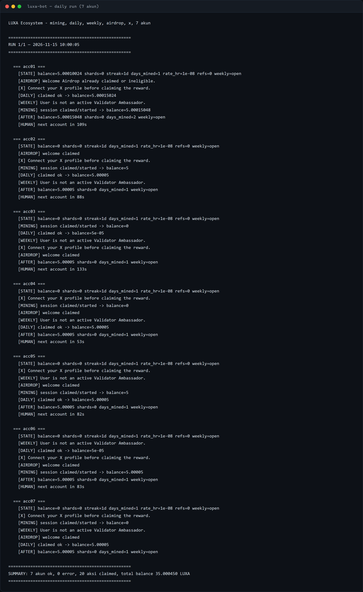

# LUXA Ecosystem — Telegram Mining Bot

Auto-farm LUXA (Cosmos L1 chain `luxa-1`) via Telegram Mini App. Multi-account mining, daily bonus, **weekly drop**, X task rewards, and airdrop claims — with a humanization layer so the fleet doesn't look like a fleet.

## Overview

| Item | Detail |
|---|---|
| **Chain** | Cosmos L1 `luxa-1` (mainnet live sejak 8 Okt 2026) |
| **Token** | LUXA (hard cap 1.002.500.000) + SHARD (10.006.000.000.000) |
| **Backend** | `luxaecosystem.alwaysdata.net/api` |
| **Auth** | Telegram WebApp `tma {initData}` |
| **Cost** | FREE (Rp 0, no deposit) |
| **TGE** | **Tidak ada** — tanpa token sale, tanpa listing eksternal |
| **Score** | 55/100 — FREE script tier (Rp 65.000) |

Riset lengkap TGE / roadmap / tokenomics / fundraise: [`docs/RESEARCH-2026-11-15.md`](docs/RESEARCH-2026-11-15.md).

## Reality check — baca ini dulu

Angka dari `/state` akun nyata, 15 Nov 2026:

```
miningRateHr   = 1e-08 LUXA/jam   ->  ~0.00000024 LUXA per 24 jam
balance        = 5.0001 LUXA      (5.0 dari welcome airdrop)
daysMined      = 1 / 60
activePioneers = 2.481 / 7.000.000
lockReason     = "60 mining days required and account KYC verification"
```

- **Mining menghasilkan ~nol.** 1 LUXA dari mining saja ≈ 11.400 tahun pada rate ini.
- Reward yang benar-benar masuk: **welcome 5 LUXA** (sekali) + daily 0,00005 LUXA/hari.
- **Weekly drop 5 LUXA ditolak untuk akun biasa** — `[WEEKLY] User is not an active Validator Ambassador.` State menampilkan `weeklyDrop.enabled: true`, tapi klaimnya hanya untuk Validator Ambassador.
- **Withdrawal terkunci** sampai 7 juta pioneer (sekarang 2.481 = 0,035%), plus 60 hari mining + KYC Sumsub.
- KYC menempel ke identitas (Sumsub dedupe), jadi dari 7 akun maksimal **1** yang bisa settle.

Bot ini tetap berguna karena gratis dan otomatis, tapi jangan berharap nilai finansial hari ini.

## Features

- Multi-account mining via Telegram Mini App (`initData` auto-generated dari session Telethon)
- Auto-start mining session (claim yield sebelumnya + mulai sesi baru)
- Daily bonus claim
- **Weekly drop claim** (`/ambassador/claim-weekly-drop`) — hanya untuk Validator Ambassador; akun biasa ditolak server (tetap dikirim karena murah, hasilnya dilaporkan apa adanya)
- X (Twitter) follow reward
- Airdrop welcome claim
- Fibonacci streak tracking (1.00x → 3.62x)
- Humanization layer (`src/humanize.py`)
- `--status` read-only, `--limit N`, `--no-jitter`, `--seed` untuk testing
- Progress per akun (`data/progress.json`) + `data/last-run.txt` / `.json`

## Humanization (`src/humanize.py`)

LUXA mendeteksi sybil dari *perilaku* ("bots, fake clickers, duplicate accounts and coordinated farms are detected and banned automatically"), bukan cuma dari jumlah wallet. Yang diacak:

| Primitif | Default | Kenapa |
|---|---|---|
| `run_jitter()` | 0–120 s | cron 08:00 tidak pernah meledak tepat 08:00:00 |
| `account_stagger()` | 45–180 s antar akun | 7 akun tidak claim dalam satu menit |
| `mission_gap()` | 6–22 s antar aksi, 15% long pause | urutan request tidak konstan |
| `action_order()` | shuffle tiap run | `state` tetap pertama (read-only), sisanya diacak |

Yang **tidak** diacak: gate yang ditegakkan server (siklus mining 24 jam, week key weekly drop). Melewati gate itu bukan humanisasi, itu kehilangan streak.

## Requirements

- Python 3.8+ (stdlib only untuk farming; Telethon hanya untuk generate `initData`)
- Session Telegram per akun (`.session`, mis. dari `tg-airdrop-bot`)
- `api_id` + `api_hash` dari my.telegram.org

## Setup

### 1. Generate initData (per akun)

```bash
python src/luxa_tg.py --api-id 2040 --api-hash YOUR_API_HASH --sessions-dir sessions/
# atau satu session (pakai path NATIVE Windows, bukan /c/...)
python src/luxa_tg.py --api-id 2040 --api-hash YOUR_API_HASH --session C:/path/account.session
```

Cara kerja: login via session → trigger Mini App launch → tangkap `initData` dari URL fragment → simpan ke `data/accounts.json`. initData LUXA expire ~24 jam, jadi regenerate sebelum run.

**Metode manual (DevTools):** buka web.telegram.org → @LuxaEcosystemBot → Launch Mini App → F12 → Network → filter `alwaysdata` → copy header `Authorization` (mulai `tma `) → `python src/luxa.py --add akun1 --init-data "tma ..."`.

### 2. Add accounts

```bash
python src/luxa.py --add akun1 --init-data "tma query_id=...&hash=..."
python src/luxa.py --list
```

### 3. Jalan

```bash
# Semua akun, semua aksi (mining, daily, weekly, airdrop, x)
python src/luxa.py

# Read-only, tidak claim apa pun
python src/luxa.py --status --no-jitter

# Test cepat 1 akun tanpa jitter
python src/luxa.py --accounts akun1 --limit 1 --no-jitter
```

## CLI flags

| Flag | Fungsi |
|---|---|
| `--status` | baca state saja, tidak ada claim |
| `--accounts a,b` | pilih label tertentu |
| `--limit N` | batasi N akun pertama |
| `--actions mining,daily,weekly,airdrop,x` | pilih aksi |
| `--no-jitter` | matikan start jitter (untuk tes) |
| `--seed N` | RNG deterministik (untuk tes) |
| `--loop N --interval S` | ulang N kali |

## How Mining Works

1. `POST /start-mining {mode: normal}` → klaim yield sesi sebelumnya + mulai sesi baru
2. Yield bertambah menurut `miningRateHr` (saat ini 1e-08 LUXA/jam — praktis nol)
3. Streak Fibonacci naik harian (1.00x → 3.62x); lewat 24 jam tanpa sesi → reset ke Day 1
4. `POST /ecosystem/chain/claim-mined` → pindah saldo ke vault `luxa1...` (**terkunci**: 60 hari + KYC + 7 juta pioneer)

## Data Files

- `data/accounts.json` — akun + initData — **KEEP PRIVATE**
- `data/progress.json` — progress per akun
- `data/last-run.txt` / `data/last-run.json` — hasil run terakhir

## Hasil run (bukti)



Kartu di atas dibaca dari `data/last-run.txt` hasil run sungguhan, bukan mockup.

## Troubleshooting

- **401 Authentication required** → initData expired (~24 jam). Jalankan ulang `luxa_tg.py`.
- **`latin-1 codec can't encode`** → username mengandung emoji. Sudah di-fix (payload di-URL-encode); kalau muncul lagi, regenerate initData.
- **`BOT_APP_INVALID`** → short name salah; LUXA pakai **`luxa`** (bukan `app`).
- **`sqlite3.OperationalError: unable to open database file`** → path session dikirim format MSYS (`/c/Users/...`). Pakai path native (`C:/Users/...`).
- **`[WEEKLY] already claimed this week`** → normal; week key reset Minggu 00:00 UTC.
- **`[STATE] rate_hr=1e-08`** → bukan error, memang rate-nya segitu.

## Disclaimer

- Auto-farming berpotensi melanggar ToS proyek. Risiko ditanggung pengguna.
- Tidak ada pasar untuk LUXA; nilai token belum terbukti dan kemungkinan besar nol.
- Mining logic off-chain di shared hosting — reward tunduk pada aturan proyek.

## References

- Website: https://luxaecosystem.xyz
- Mining app: https://app.luxaecosystem.xyz
- Whitepaper v3.0: https://luxaecosystem.xyz/whitepaper.html
- KYC portal: https://luxaecosystem.xyz/kyc.html
- Endpoint research: `~/HERMES DATA/airdrop-tracker/knowledge-graph/data/luxa-ecosystem-endpoints.md`
- Riset proyek: `docs/RESEARCH-2026-11-15.md`
